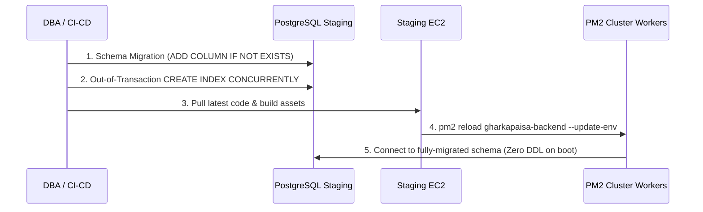

# GharKaPaisa Staging Validation & Safe Migration Runbook

**Version:** 1.0.0  
**Date:** October 2026  
**Audience:** PostgreSQL DBA, DevOps Engineers, Senior Backend Engineers  
**Target Environment:** Staging (Pre-Production Validation)  
**Safety Status:** PREPARATION ONLY — No migrations or AWS commands executed without explicit authorization.

---

## 1. Safety Boundaries & Environment Verification

- **Direct Connections:** Production & Staging currently connect directly via PostgreSQL TCP sockets (`DB_HOST` in `.env`). No AWS RDS Proxy is active unless the host endpoint matches `*.proxy-*.rds.amazonaws.com`.
- **Concurrency Limit:** Each PM2 worker maintains its own connection pool. Total potential connections = `(DB_POOL_MAX || 30) × (PM2 workers per EC2) × (EC2 instances)`. Ensure `max_connections` on PostgreSQL RDS instance exceeds this sum.
- **Controlled DDL:** Never execute migrations concurrently from multiple PM2 cluster workers. Migrations must execute once via a dedicated CLI pre-flight process.

---

## 2. Pre-Migration Database Backup & Snapshot Verification

Before performing any migration or schema change on Staging, verify backup readiness:

```bash
# 1. Verify most recent automated snapshot or point-in-time recovery window
aws rds describe-db-snapshots \
  --db-instance-identifier gharkapaisa-staging-db \
  --region ap-south-1 \
  --query "DBSnapshots[-1].[DBSnapshotIdentifier,SnapshotCreateTime,Status,PercentProgress]" \
  --output table

# 2. Manual Pre-Migration Snapshot (Execute ONLY when operator is authorized)
# aws rds create-db-snapshot \
#   --db-instance-identifier gharkapaisa-staging-db \
#   --db-snapshot-identifier gharkapaisa-staging-pre-migration-$(date +%Y%m%d%H%M) \
#   --region ap-south-1
```

---

## 3. Read-Only Schema Inspection Queries (Operator Execution)

Run these queries in PostgreSQL (`psql` or pgAdmin) to inspect current target schema and resolve data type uncertainties:

### 3.1 Inspect Uncertain Column Definitions
```sql
SELECT 
    table_name,
    column_name,
    data_type,
    character_maximum_length,
    numeric_precision,
    numeric_scale,
    is_nullable,
    column_default
FROM information_schema.columns
WHERE (table_name = 'applications' AND column_name IN (
    'bank_smart_emi_offer', 'smart_emi_amount', 'sales_operator_code', 'remark_status', 'ipa_stage'
))
OR (table_name = 'employee_candidates' AND column_name IN (
    'hr_name', 'target_role'
))
OR (table_name = 'partner_profiles' AND column_name IN (
    'referred_by_employee_id'
))
OR (table_name = 'products' AND column_name IN (
    'processing_fee'
))
ORDER BY table_name, column_name;
```

### 3.2 Check Existing Indexes on Target Tables
```sql
SELECT
    schemaname,
    tablename,
    indexname,
    indexdef
FROM pg_indexes
WHERE tablename IN ('applications', 'physical_application_details', 'employee_candidates', 'partner_profiles', 'products')
ORDER BY tablename, indexname;
```

### 3.3 Check for Invalid Indexes (`indisvalid = false`)
```sql
SELECT 
    c.relname AS invalid_index_name,
    t.relname AS table_name,
    i.indisvalid,
    i.indisunique,
    pg_size_pretty(pg_relation_size(c.oid)) AS index_size
FROM pg_index i
JOIN pg_class c ON c.oid = i.indexrelid
JOIN pg_class t ON t.oid = i.indrelid
JOIN pg_namespace n ON n.oid = t.relnamespace
WHERE n.nspname = 'public'
  AND t.relname IN ('applications', 'physical_application_details', 'employee_candidates', 'partner_profiles', 'products')
  AND i.indisvalid = false;
```

### 3.4 Check Existing Constraints
```sql
SELECT
    conrelid::regclass AS table_name,
    conname AS constraint_name,
    contype AS constraint_type,
    pg_get_constraintdef(c.oid) AS constraint_definition
FROM pg_constraint c
JOIN pg_namespace n ON n.oid = c.connamespace
WHERE n.nspname = 'public'
  AND conrelid::regclass::text IN ('applications', 'physical_application_details', 'employee_candidates', 'partner_profiles', 'products')
ORDER BY table_name, conname;
```

### 3.5 Sample Existing Data for `bank_smart_emi_offer`
```sql
-- Check if column exists, row count, and if any values contain non-numeric characters:
DO $$
BEGIN
  IF EXISTS (
    SELECT 1 FROM information_schema.columns 
    WHERE table_name = 'applications' AND column_name = 'bank_smart_emi_offer'
  ) THEN
    RAISE NOTICE 'Column applications.bank_smart_emi_offer exists.';
  ELSE
    RAISE NOTICE 'Column applications.bank_smart_emi_offer DOES NOT EXIST yet.';
  END IF;
END $$;

-- If exists, run:
SELECT 
    COUNT(*) AS total_rows,
    COUNT(bank_smart_emi_offer) AS non_null_count,
    COUNT(*) FILTER (WHERE bank_smart_emi_offer::text ~ '[^0-9.]') AS non_numeric_format_count
FROM applications;

SELECT DISTINCT bank_smart_emi_offer::text
FROM applications
WHERE bank_smart_emi_offer IS NOT NULL
LIMIT 20;
```

---

## 4. Single-Process Migration Execution Protocol

### Why PM2 Boot Migrations Must Be Avoided
In production (`production_pm2_decoded.log`), 14 boot migrations in `server.js` run simultaneously across PM2 cluster workers. This creates:
1. `40P01` (deadlock detected) during simultaneous `ALTER TABLE` / `CREATE TABLE` execution.
2. Connection exhaustion during cluster boot.

### Staging Single-Process Execution
Execute formal migrations once from a single process BEFORE starting or reloading the application:

```bash
# Set environment and execute the dedicated migration client
export NODE_ENV=staging
cd /home/ubuntu/GharKaPaisa/backend

# Verify migration file syntax
node --check src/database/migrations/migrate_consolidated_application_stage_columns.js

# Execute single-process migration
node src/database/migrations/migrate_consolidated_application_stage_columns.js
```

---

## 5. Concurrent Index Creation (Out-of-Transaction)

The migration script executes these indexes outside of a transaction block with automatic invalid index cleanup:

```sql
-- Clean up any aborted builds first:
DROP INDEX CONCURRENTLY IF EXISTS idx_apps_status_created_desc;
DROP INDEX CONCURRENTLY IF EXISTS idx_apps_remark_pending_prod;
DROP INDEX CONCURRENTLY IF EXISTS idx_apps_sales_operator_code;
DROP INDEX CONCURRENTLY IF EXISTS idx_apps_remark_operator_code;

-- Create justified performance indexes concurrently:
CREATE INDEX CONCURRENTLY IF NOT EXISTS idx_apps_status_created_desc 
ON applications(status, created_at DESC);

CREATE INDEX CONCURRENTLY IF NOT EXISTS idx_apps_remark_pending_prod 
ON applications(product_id, created_at DESC) 
WHERE COALESCE(remark_status, 'PENDING') = 'PENDING';

CREATE INDEX CONCURRENTLY IF NOT EXISTS idx_apps_sales_operator_code 
ON applications(sales_operator_code) 
WHERE sales_operator_code IS NOT NULL;

CREATE INDEX CONCURRENTLY IF NOT EXISTS idx_apps_remark_operator_code 
ON applications(remark_operator_code) 
WHERE remark_operator_code IS NOT NULL;
```

---

## 6. Application Deployment Order (Expand-and-Contract)



1. **Step 1:** Execute database migration script (`migrate_consolidated_application_stage_columns.js`).
2. **Step 2:** Verify columns and valid indexes in PostgreSQL.
3. **Step 3:** Deploy frontend build:
   ```bash
   cd /home/ubuntu/GharKaPaisa/frontend
   npm ci
   npm run build
   ```
4. **Step 4:** Reload backend cluster gracefully:
   ```bash
   cd /home/ubuntu/GharKaPaisa/backend
   npm ci --production
   pm2 reload gharkapaisa-backend --update-env
   ```

---

## 7. Post-Deployment Verification & API Regression Checks

### 7.1 Service Health
```bash
curl -I -s http://localhost:5000/api/v1/health || curl -I -s http://localhost:5000/
# Expected: HTTP/1.1 200 OK
```

### 7.2 Export Truncation Boundary Test
```bash
# 1. Interactive request (should be bounded to 200 max)
curl -s -H "Authorization: Bearer <STAGING_TOKEN>" "http://localhost:5000/api/v1/applications?page=1&limit=500" | jq '.pagination'
# Expected: limit = 200, returned_count <= 200

# 2. Export request (should allow up to 10,000 max with truncation flags)
curl -s -H "Authorization: Bearer <STAGING_TOKEN>" "http://localhost:5000/api/v1/applications?export=true&limit=10000" | jq '.pagination'
# Expected: limit = 10000, is_truncated = (total > 10000), total_matching = <total>
```

### 7.3 PM2 Log Inspection
```bash
pm2 logs gharkapaisa-backend --lines 60 --nostream
# Verify: 0 "deadlock detected" (40P01) errors, 0 connection timeout errors
```

---

## 8. CRM Query-Plan Comparisons (`EXPLAIN (ANALYZE, BUFFERS)`)

Run this query before and after indexing on staging to measure execution time and buffer usage:

```sql
EXPLAIN (ANALYZE, BUFFERS)
SELECT a.id, a.app_number, a.status, a.created_at, p.name AS product_name
FROM applications a
LEFT JOIN products p ON p.id = a.product_id
WHERE a.status = 'approved'
ORDER BY a.created_at DESC
LIMIT 50 OFFSET 0;
```
- **Before Index:** Look for `Sort Method: quicksort` or `external merge` and high `Buffers: shared hit/read`.
- **After Index:** Look for `Index Scan using idx_apps_status_created_desc on applications`.

---

## 9. Connection Pool Monitoring

Run this query in PostgreSQL while running smoke tests to verify connection health:

```sql
SELECT 
    count(*) AS total_connections,
    count(*) FILTER (WHERE state = 'active') AS active_connections,
    count(*) FILTER (WHERE state = 'idle') AS idle_connections,
    count(*) FILTER (WHERE state = 'idle in transaction') AS idle_in_transaction,
    count(*) FILTER (WHERE wait_event_type IS NOT NULL) AS waiting_connections
FROM pg_stat_activity
WHERE datname = current_database();
```

---

## 10. Rollback & Contingency Plan

If any critical issue arises during staging deployment:

1. **Application Code Rollback:**
   ```bash
   cd /home/ubuntu/GharKaPaisa/backend
   git checkout <PREVIOUS_COMMIT_HASH>
   pm2 reload gharkapaisa-backend --update-env
   ```
2. **Schema Rollback:**
   - The added columns (`ADD COLUMN IF NOT EXISTS`) are nullable and non-destructive. They do **not** require dropping because previous code versions simply ignore them.
   - If an index causes write degradation, drop it without locking:
     ```sql
     DROP INDEX CONCURRENTLY IF EXISTS idx_apps_status_created_desc;
     DROP INDEX CONCURRENTLY IF EXISTS idx_apps_remark_pending_prod;
     DROP INDEX CONCURRENTLY IF EXISTS idx_apps_sales_operator_code;
     DROP INDEX CONCURRENTLY IF EXISTS idx_apps_remark_operator_code;
     ```
